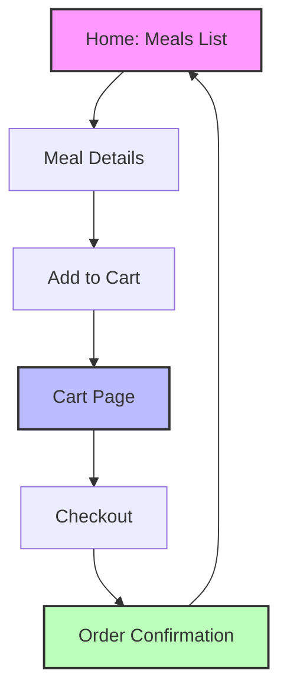

# Food Ordering App

A full-stack food ordering application built with React (Vite) for the frontend and Node.js/Express for the backend.

## Features

- Browse available meals with details
- Add meals to cart and manage cart items
- View cart and proceed to checkout
- User progress tracking (if implemented)
- Responsive design for mobile and desktop

## App Flow



## Technologies Used

### Frontend
- **Framework**: React with Vite
- **Language**: JavaScript (ES6+)
- **State Management**: React Context API
- **Styling**: CSS
- **Build Tool**: Vite
- **Linting**: ESLint

### Backend
- **Runtime**: Node.js
- **Framework**: Express.js
- **Data Storage**: JSON files (for simplicity)
- **API**: RESTful endpoints

## Setup and Installation

### Prerequisites
- Node.js (v16 or higher)
- npm (v8 or higher)

### Frontend Setup
1. Clone the repository
2. Install frontend dependencies:
   ```bash
   npm install
   ```

### Backend Setup
1. Navigate to the backend directory:
   ```bash
   cd backend
   ```
2. Install backend dependencies:
   ```bash
   npm install
   ```

## Running the Application

### Development Mode
1. Start the backend server (from backend directory):
   ```bash
   npm start
   ```
2. In a new terminal, start the frontend development server (from project root):
   ```bash
   npm run dev
   ```
3. Open your browser to `http://localhost:5173` (or the URL shown in the terminal)

### Production Build
1. Build the frontend for production:
   ```bash
   npm run build
   ```
2. Preview the production build:
   ```bash
   npm run preview
   ```
3. Ensure the backend is running (`npm start` from backend directory)

## Project Structure
```
food-ordering/
├── backend/                 # Backend server (Node.js/Express)
│   ├── app.js              # Main server file
│   ├── package.json        # Backend dependencies
│   └── data/               # JSON data files
├── public/                 # Static assets
├── src/                    # Frontend source code
│   ├── components/         # React components
│   ├── hooks/              # Custom hooks
│   ├── store/              # Context providers
│   ├── util/               # Utility functions
│   ├── App.jsx             # Main app component
│   ├── main.jsx            # Entry point
│   └── index.css           # Global styles
├── index.html              # HTML template
├── package.json            # Frontend dependencies & scripts
├── vite.config.js          # Vite configuration
└── README.md               # This file
```

## Available Scripts (Frontend)
- `npm run dev` - Start development server
- `npm run build` - Build for production
- `npm run preview` - Preview production build
- `npm run lint` - Run ESLint (if configured)

## Backend Scripts
- `npm start` - Start the backend server (runs `node app.js`)

---

*Built with ❤️ using React, Vite, and Node.js*
